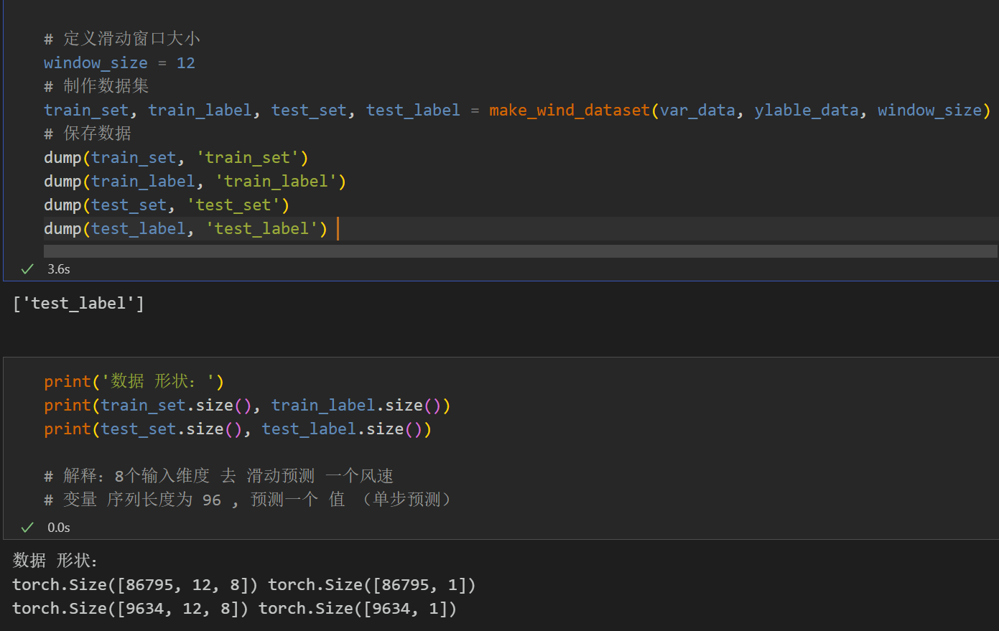
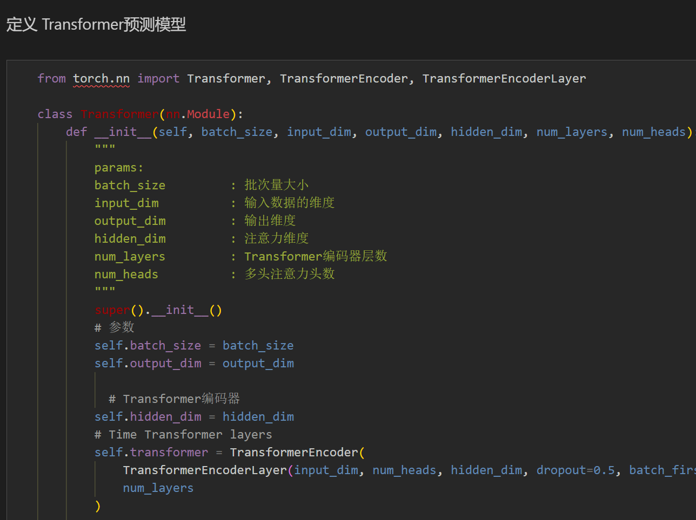
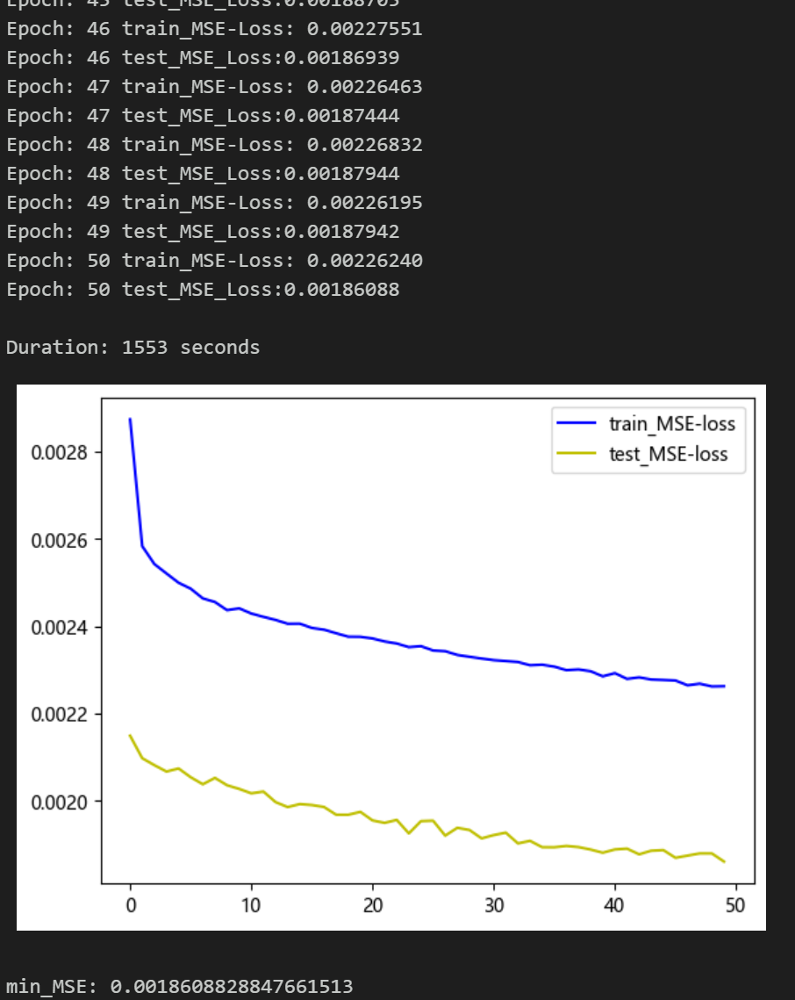
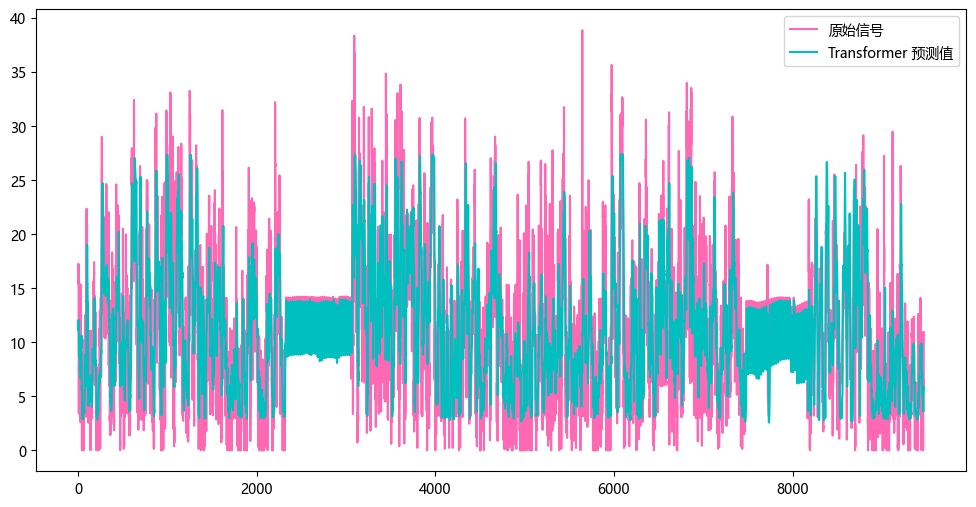
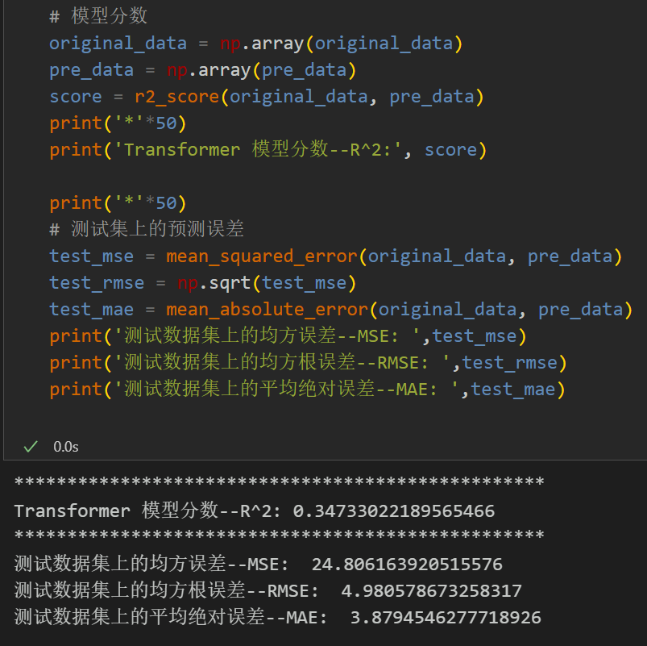

# Multi-feature Variable Sequence Prediction - Transformer Prediction Model

Single variable includes the following content:
Including wind speed data, as well as the already generated and prepared wind speed dataset and label set, corresponding codes can be run.
Includes code for data preprocessing, complete Transformer model prediction code, and visualization code.
Environment: Python 3.9
This paper introduces a Transformer model for multi-feature variable sequence prediction based on the preliminary introduced wind speed data (see dataset at the end of this text). This model aims to enhance the predictive performance of time series data. The dataset consists of nine variables including weather, temperature, humidity, pressure, and wind speed. By using a sliding window to create the dataset, multiple variables are utilized to predict wind speed.
1. Dataset Preparation and Preprocessing for Multi-Feature Variables
1.1 Import data
1.2 Dataset Preparation and Preprocessing
First, divide the dataset into training and testing sets in a ratio of 9:1.
Creating dataset
\n        \n  
2. Transformer prediction model based on Pytorch
2.1 Define the Transformer prediction model
\n        \n  
2.2 Set parameters and train the model
\n        \n  
50 epochs, MSE is 0.001860, the multi-variable feature Transformer prediction effect is good, appropriately adjusting model parameters can further improve the model prediction performance.
Please adjust the parameters:
The number of Transformer encoder layers and dimensions can be appropriately increased, and the learning rate can be fine-tuned.
Increase more epochs (note to prevent overfitting)
The sliding window length can be changed (set an appropriate window length).
3. Model Evaluation and Visualization
3.1 Results Visualization
\n        \n  
3.2 Model Evaluation
\n        \n  

## Images

<!-- PAYMENT_BLOCK -->

## Get this dataset

- Payment link (Stripe): [Buy now](https://buy.stripe.com/3cs8yP7sY87d0vu9AB)
- Payment QR code: 

<!-- /PAYMENT_BLOCK -->
